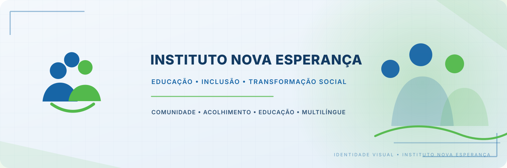
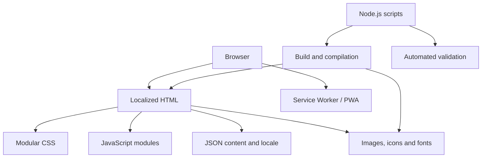

<p align="right"><strong>Idioma:</strong> <a href="README.md">Português (Brasil)</a> · <a href="README.en.md">English</a></p>

<div align="center">
  
  <br/>
  <h1>Instituto Nova Esperança</h1>
  <p><strong>Multilingual institutional platform · Web · PWA</strong></p>
  <p>
    
    
    
    
    
  </p>
  <p>
    <a href="https://github.com/RMBarros-Dev/instituto-nova-esperanca/actions/workflows/ci.yml"></a>
    <a href="https://github.com/RMBarros-Dev/instituto-nova-esperanca/actions/workflows/codeql.yml"></a>
  </p>
</div>

## Contents

- [01 · Overview](#01--overview)
- [02 · Purpose and Application Context](#02--purpose-and-application-context)
- [03 · Objectives](#03--objectives)
- [04 · Functional Areas](#04--functional-areas)
- [05 · Technology Stack](#05--technology-stack)
- [06 · Architecture](#06--architecture)
- [07 · Localization and Languages](#07--localization-and-languages)
- [08 · Accessibility](#08--accessibility)
- [09 · Progressive Web App](#09--progressive-web-app)
- [10 · Requirements](#10--requirements)
- [11 · Installation and Local Execution](#11--installation-and-local-execution)
- [12 · Development Methodology](#12--development-methodology)
- [13 · Build and Quality Validation](#13--build-and-quality-validation)
- [14 · Repository Structure](#14--repository-structure)
- [15 · Accessibility, Internationalization and Limitations](#15--accessibility-internationalization-and-limitations)
- [16 · Documentation and Engineering Principles](#16--documentation-and-engineering-principles)
- [17 · Maintenance and Contribution](#17--maintenance-and-contribution)
- [18 · License and Attribution](#18--license-and-attribution)

## 01 · Overview

This repository contains a multilingual institutional website with localized page directories, JSON content, Progressive Web App resources and custom scripts for development, build and validation. The declared package version is 7.4.0.

## 02 · Purpose and Application Context

The project is designed to organize and present institutional content on the Web. Its structure includes information about the institution, projects, impact, transparency, communication, volunteering and contact, with navigation across locales.

The repository structure documents the technical implementation. It does not independently validate institutional claims, partnerships, impact metrics or third-party content.

## 03 · Objectives

- Organize pages and content by locale.
- Keep structured content in JSON files.
- Provide PWA installation and runtime resources.
- Maintain a consistent visual identity and interface components.
- Provide build, compilation and automated validation scripts.

## 04 · Functional Areas

| Area | Evidence in repository |
|---|---|
| Institutional pages | `index.html`, `sobre.html` and localized equivalents. |
| Projects and impact | Localized pages, JSON data and visual assets. |
| Transparency | Dedicated pages, JSON data and open-data scripts. |
| Communication | Blog and press pages, data and media assets. |
| Donations and volunteering | Dedicated pages and scripts. |
| Accessibility | Styles, icons and accessibility scripts. |
| Localization | Locale-specific pages and JSON resources. |
| PWA | Web manifest, icons and Service Worker. |

Directory presence demonstrates code organization, not independent validation of the content.

## 05 · Technology Stack

| Layer | Technologies |
|---|---|
| Markup | HTML5 |
| Styling | Modular CSS3 |
| Behavior | JavaScript |
| Structured content | JSON |
| Development tools | Node.js |
| Web capabilities | PWA, Web App Manifest and Service Worker |
| Internationalization | Locale-specific JSON and localized pages |
| Quality | Custom route, image, link, HTML, content, SEO, accessibility and i18n checks |

Dependencies and scripts are defined in `package.json` and `package-lock.json`.

## 06 · Architecture

The application is a static multi-page website with localized content and shared assets.



The reviewed structure does not indicate a business backend or connected relational database. Any external integrations shown by pages must be assessed individually.

## 07 · Localization and Languages

The repository includes locale-specific pages and content resources. Identified page directories include Brazilian Portuguese, US English, Spanish, French, German and Japanese. Review the actual locale files before treating translations as complete.

## 08 · Accessibility

The project includes dedicated styles and scripts for interface preferences such as contrast, font size and reading support. Automated checks are useful indicators but do not establish WCAG conformance or replace assistive-technology testing and manual review.

## 09 · Progressive Web App

The repository includes a Web App Manifest, installation icons and a Service Worker. These files provide the basis for PWA behavior; installation, caching and update behavior should be verified in supported browsers and devices.

## 10 · Requirements

- Node.js installed.
- npm available on PATH.
- Git for cloning and version control.
- A modern browser for local validation.

The exact Node.js version is not declared in `package.json`; inspect dependencies and scripts if compatibility issues occur.

## 11 · Installation and Local Execution

```bash
git clone https://github.com/RMBarros-Dev/instituto-nova-esperanca.git
cd instituto-nova-esperanca
npm ci
npm run dev
```

The local server is started by `scripts/dev_server.js`. Check the terminal output for the local address.

## 12 · Development Methodology

The workflow is organized around localized content and custom scripts:

1. Structure pages and content by locale.
2. Separate data, styles, scripts and visual assets.
3. Generate or compile required pages and assets.
4. Run automated validations.
5. Review pages visually and fix identified issues.
6. Inspect generated changes with Git before committing.

The build command may modify repository files. Always review generated output before versioning it.

## 13 · Build and Quality Validation

Commands defined in `package.json` include:

| Command | Purpose |
|---|---|
| `npm run qa` | Run the project's validation orchestrator. |
| `npm test` | Run the same QA orchestrator. |
| `npm run test:i18n` | Validate internationalization resources. |
| `npm run audit:project` | Audit project organization. |
| `npm run build` | Generate assets, compile locales and build pages. |
| `npm run build:pages` | Build localized pages. |

Run locally:

```bash
npm run qa
npm run test:i18n
npm run audit:project
```

Current results must be obtained by running the commands. Documentation does not claim QA approval without actual execution and review.

## 14 · Repository Structure

```text
assets/
  brand/       # repository visual identity
  css/         # tokens, base, layout and components
  data/        # structured JSON content
  icons/       # categorized icons
  img/         # images, banners and illustrations
  js/          # interaction and validation modules
  locales/     # localized resources
docs/          # design system, brand and project guidance
scripts/       # build, generation and validation
lang/          # JSON content by language
pt-BR/ en-US/ es-ES/ fr-FR/ de-DE/ ja-JP/
documents/
index.html
manifest.webmanifest
service-worker.js
package.json
README.md
```

This is a high-level view; the repository contains additional files and specialized resources.

## 15 · Accessibility, Internationalization and Limitations

The project contains locale resources and accessibility-oriented functionality. Automated scripts do not equal WCAG certification, and the existence of translation files does not prove that every translation has been linguistically reviewed.

Institutional content, reports, documents, indicators and third-party references require source verification, authorization and freshness checks before being treated as official information.

## 16 · Documentation and Engineering Principles

- [Design System](docs/design-system.md) — tokens, principles, typography and visual organization.
- [Brand guide](docs/brand/README.md) — logo, banner and project palette.
- [Project structure](docs/project-structure.md) — directory responsibilities and conventions.
- [Screenshots](docs/screenshots/) — available visual references.
- [Visual production prompts](docs/nano-banana-prompts.md) — project reference material.
- [PWA manifest](manifest.webmanifest).
- [Scripts](scripts/) — build, asset generation and validation.

The project emphasizes modular organization, separation of content and presentation, accessibility, responsive design, consistent locale codes, reproducible checks and documentation aligned with the code.

## 17 · Maintenance and Contribution

Review generated files before committing. Keep locale content aligned, test navigation in supported browsers, and verify accessibility manually in addition to automated checks. Do not publish unverified institutional claims or third-party materials without permission.

## 18 · License and Attribution

No license file was found in the current repository tree. Do not assume that the code or materials are distributed under MIT or another open-source license; reuse requires permission from the rights holder. Third-party trademarks, names, documents, photographs and materials remain subject to their respective rights and permissions.
