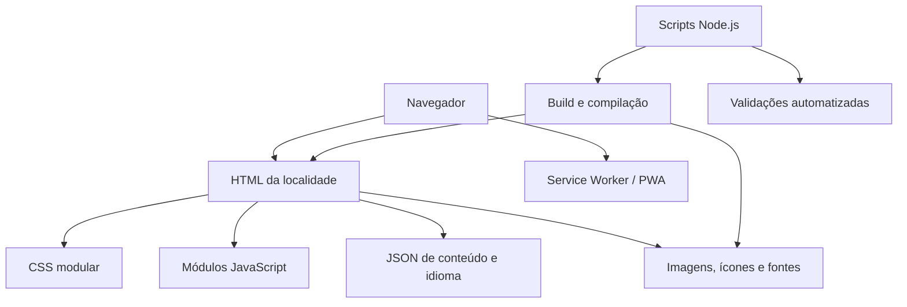

<p align="right"><strong>Idioma:</strong> <a href="README.md">Português (Brasil)</a> · <a href="README.en.md">English</a></p>

<div align="center">
  
  <br/>
  <h1>Instituto Nova Esperança</h1>
  <p><strong>Plataforma institucional multilíngue · Web · PWA</strong></p>
  <p>
    
    
    
    
    
    
  </p>
  <p>
    <a href="https://github.com/RMBarros-Dev/instituto-nova-esperanca/actions/workflows/ci.yml"></a>
    <a href="https://github.com/RMBarros-Dev/instituto-nova-esperanca/actions/workflows/codeql.yml"></a>
  </p>
</div>

## Índice

- [01 · Contexto e posicionamento](#01--contexto-e-posicionamento)
- [02 · Demonstração real e referências visuais](#02--demonstracao-real-e-referencias-visuais)
- [03 · Funcionalidades e estado de implementação](#03--funcionalidades-e-estado-de-implementacao)
- [04 · Arquitetura geral](#04--arquitetura-geral)
- [05 · Stack tecnológica](#05--stack-tecnologica)
- [06 · Estrutura de diretórios](#06--estrutura-de-diretorios)
- [07 · Pré-requisitos e instalação](#07--pre-requisitos-e-instalacao)
- [08 · Configuração de ambiente e dados](#08--configuracao-de-ambiente-e-dados)
- [09 · Guia de utilização](#09--guia-de-utilizacao)
- [10 · Testes e qualidade](#10--testes-e-qualidade)
- [11 · Internacionalização e localização](#11--internacionalizacao-e-localizacao)
- [12 · Deploy e infraestrutura](#12--deploy-e-infraestrutura)
- [13 · Segurança e limitações](#13--seguranca-e-limitacoes)
- [14 · Documentação complementar](#14--documentacao-complementar)
- [15 · Contribuição, licença e créditos](#15--contribuicao-licenca-e-creditos)

## 01 · Contexto e posicionamento

### Identificação e resumo

Este repositório contém uma plataforma Web institucional com páginas organizadas por idioma, conteúdo em JSON, recursos de Progressive Web App (PWA) e scripts próprios para desenvolvimento, compilação e validação. A versão declarada no pacote é 7.4.0.

A aplicação utiliza arquitetura de site estático multipágina. O conteúdo e os recursos de interface são distribuídos em arquivos do projeto; a estrutura documentada não indica uma aplicação backend de negócio ou banco de dados relacional associado.

### Contexto e objetivos

O projeto está direcionado à apresentação e organização de conteúdo institucional em ambiente Web. Seus objetivos técnicos incluem organizar páginas por localidade, separar conteúdo estruturado, oferecer recursos PWA, manter identidade visual consistente e automatizar verificações.

A existência de páginas e módulos não comprova, por si só, a veracidade de afirmações institucionais, parcerias, indicadores ou resultados de impacto.

## 02 · Demonstração real e referências visuais

O repositório documenta referências visuais em [`docs/screenshots/`](docs/screenshots/). A execução pode ser reproduzida localmente conforme as instruções; não foi indicada uma URL pública de demonstração nesta documentação.

## 03 · Funcionalidades e estado de implementação

O estado apresentado nesta seção corresponde ao escopo descrito no README e no material referenciado pelo repositório. Não equivale, por si só, a homologação operacional ou validação independente.

### Áreas funcionais

A estrutura do repositório contempla áreas relacionadas a:
- apresentação institucional;
- projetos e impacto;
- transparência;
- comunicação, blog e imprensa;
- doações e voluntariado;
- acessibilidade;
- localização e navegação por idioma;
- instalação e funcionamento PWA.

### Funcionalidades e conteúdo

| Área | Evidência na estrutura |
|---|---|
| Páginas institucionais | `index.html`, `sobre.html` e equivalentes localizados. |
| Projetos e impacto | Páginas localizadas, dados JSON e recursos visuais. |
| Transparência | Páginas específicas, dados JSON e scripts relacionados a dados abertos. |
| Comunicação | Páginas de blog e imprensa, dados e imagens. |
| Doações e voluntariado | Páginas e scripts dedicados. |
| Acessibilidade | Estilos, ícones e script de acessibilidade. |
| Localização | Páginas e dados organizados por idioma. |
| PWA | Manifesto, ícones e Service Worker. |

A presença de diretórios e módulos comprova a organização desses recursos no código; não representa validação independente de conteúdo institucional.

### Acessibilidade

O projeto inclui estilos e scripts dedicados a preferências de interface, como contraste, tamanho de fonte e suporte à leitura. Verificações automatizadas são indicadores úteis, mas não constituem certificação WCAG nem substituem testes com tecnologias assistivas e revisão manual.

### Progressive Web App

O repositório contém Web App Manifest, ícones de instalação e Service Worker. Esses recursos formam a base da experiência PWA; instalação, cache e atualização devem ser verificados nos navegadores e dispositivos suportados.

## 04 · Arquitetura geral

### Arquitetura

A aplicação é um site estático multipágina com conteúdo localizado e recursos compartilhados.



A estrutura revisada não indica backend de negócio ou banco de dados conectado. Integrações externas apresentadas nas páginas devem ser verificadas individualmente.

## 05 · Stack tecnológica

### Linguagens e tecnologias

| Camada | Tecnologias identificadas |
|---|---|
| Marcação | HTML5 |
| Estilos | CSS3 modular |
| Comportamento | JavaScript |
| Conteúdo estruturado | JSON |
| Ferramentas de desenvolvimento | Node.js |
| Aplicação Web | PWA, Web App Manifest e Service Worker |
| Internacionalização | Arquivos JSON por localidade e páginas localizadas |
| Qualidade | Scripts próprios para rotas, imagens, links, HTML, conteúdo, SEO, acessibilidade e i18n |

Dependências e comandos estão definidos em `package.json` e `package-lock.json`.

## 06 · Estrutura de diretórios

### Estrutura de arquivos

```text
assets/
  brand/       # identidade visual do repositório
  css/         # tokens, base, layout e componentes
  data/        # conteúdo JSON estruturado
  icons/       # ícones por categoria
  img/         # imagens, banners e ilustrações
  js/          # módulos de interação e validação
  locales/     # recursos localizados
docs/          # design system, marca e orientações
scripts/       # build, geração e validação
lang/          # conteúdo JSON por idioma
pt-BR/ en-US/ es-ES/ fr-FR/ de-DE/ ja-JP/
documents/
index.html
manifest.webmanifest
service-worker.js
package.json
README.md
```

A estrutura é uma visão geral; o repositório contém outros arquivos e recursos especializados.

## 07 · Pré-requisitos e instalação

### Requisitos

- Node.js instalado.
- npm disponível no PATH.
- Git para clonar e versionar o repositório.
- Navegador moderno para validação local.

A versão exata do Node.js não está declarada em `package.json`; consulte as dependências e scripts se ocorrer incompatibilidade.

### Instalação e execução

```bash
git clone https://github.com/RMBarros-Dev/instituto-nova-esperanca.git
cd instituto-nova-esperanca
npm ci
npm run dev
```

O servidor local é iniciado por `scripts/dev_server.js`. Consulte a saída do terminal para identificar o endereço local.

## 08 · Configuração de ambiente e dados

O README atual não descreve arquivo `.env` nem variáveis de ambiente específicas. Não armazene segredos no controle de versão.

## 09 · Guia de utilização

Consulte os comandos de instalação e execução. O guia não presume fluxos adicionais além daqueles descritos no repositório.

## 10 · Testes e qualidade

### Build e validação de qualidade

Comandos definidos em `package.json`:

| Comando | Finalidade |
|---|---|
| `npm run qa` | Executa o orquestrador de validações. |
| `npm test` | Executa o mesmo orquestrador de QA. |
| `npm run test:i18n` | Verifica recursos de internacionalização. |
| `npm run audit:project` | Audita a organização do projeto. |
| `npm run build` | Gera ativos, compila localidades e constrói páginas. |
| `npm run build:pages` | Constrói páginas localizadas. |

Execute localmente:

```bash
npm run qa
npm run test:i18n
npm run audit:project
```

Os resultados atuais dependem da execução real dos comandos. A documentação não declara aprovação de QA sem execução e análise do resultado.

## 11 · Internacionalização e localização

### Internacionalização e localização

O repositório inclui páginas e recursos por localidade. Os diretórios identificados incluem português do Brasil, inglês dos Estados Unidos, espanhol, francês, alemão e japonês. Consulte os arquivos efetivos antes de considerar uma tradução completa.

## 12 · Deploy e infraestrutura

A documentação atual não identifica um provedor ou ambiente de produção publicado. O processo de deploy precisa ser definido e validado antes de qualquer afirmação de disponibilidade.

## 13 · Segurança e limitações

### Limitações e validação institucional

A existência de scripts de validação não equivale a certificação WCAG, e a presença de arquivos de idioma não comprova revisão linguística integral. Conteúdo institucional, relatórios, documentos, indicadores e referências de terceiros exigem verificação de origem, autorização e atualização antes de serem tratados como informação oficial.

## 14 · Documentação complementar

### Documentação e princípios

- [Design System](docs/design-system.md) — tokens, princípios, tipografia e organização visual.
- [Identidade visual](docs/brand/README.md) — logotipo, banner e paleta.
- [Estrutura do projeto](docs/project-structure.md) — responsabilidades dos diretórios.
- [Capturas de tela](docs/screenshots/) — referências visuais disponíveis.
- [Prompts de produção visual](docs/nano-banana-prompts.md).
- [Manifesto PWA](manifest.webmanifest).
- [Scripts](scripts/) — build, geração de ativos e validação.

O projeto prioriza organização modular, separação de conteúdo e apresentação, acessibilidade, responsividade, códigos de localidade consistentes e verificações reproduzíveis.

## 15 · Contribuição, licença e créditos

Ao propor alterações, descreva o objetivo, os arquivos afetados e a validação realizada. Prefira mudanças pequenas e revisáveis; inclua testes quando alterar comportamento e nunca envie credenciais, tokens ou dados pessoais.

### Metodologia de desenvolvimento

O fluxo é organizado em torno de conteúdo localizado e scripts próprios:

1. Estruturar páginas e conteúdo por localidade.
2. Separar dados, estilos, scripts e recursos visuais.
3. Gerar ou compilar páginas e ativos necessários.
4. Executar validações automatizadas.
5. Revisar visualmente as páginas e corrigir problemas.
6. Inspecionar alterações geradas com Git antes de criar commits.

O build pode modificar arquivos no repositório. Revise sempre o resultado antes de versioná-lo.

### Manutenção e contribuição

Revise arquivos gerados antes de criar commits. Mantenha conteúdo localizado alinhado, teste navegação nos navegadores suportados e valide acessibilidade manualmente além das verificações automatizadas. Não publique afirmações institucionais não verificadas ou materiais de terceiros sem autorização.

### Licença e atribuição

Não foi identificado um arquivo de licença na árvore atual do repositório. Portanto, não presuma que o código ou os materiais estejam sob MIT ou outra licença aberta; a reutilização depende de autorização do titular dos direitos. Marcas, nomes, documentos, fotografias e materiais de terceiros permanecem sujeitos aos respectivos direitos e autorizações.
