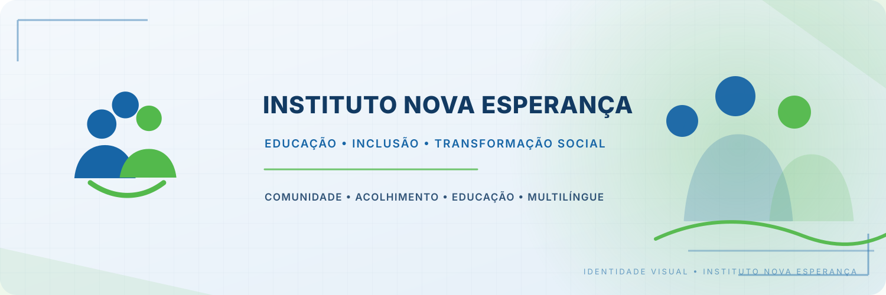
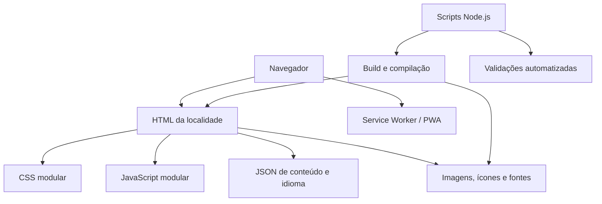

<p align="right"><strong>Idioma:</strong> <a href="README.md">Português (Brasil)</a> · <a href="README.en.md">English</a></p>

<div align="center">
  
  <br/>
  
  <h1>Instituto Nova Esperança</h1>
  <p><strong>Plataforma institucional multilíngue • Web • PWA</strong></p>
  <p>
    
    
    
    
    
    
  </p>
</div>


<p align="center">
  <a href="https://github.com/RMBarros-Dev/instituto-nova-esperanca/actions/workflows/ci.yml"></a>
  <a href="https://github.com/RMBarros-Dev/instituto-nova-esperanca/actions/workflows/codeql.yml"></a>
</p>

---

## 01. Identificação e resumo

Este repositório contém uma plataforma web institucional com páginas organizadas por idioma, conteúdos em JSON, recursos de Progressive Web App (PWA) e scripts próprios para desenvolvimento, compilação e validação.

A aplicação utiliza uma arquitetura de site estático multipágina. O conteúdo das páginas e os recursos de interface são distribuídos em arquivos do próprio projeto; não há, na estrutura documentada, uma aplicação backend de negócio ou banco de dados relacional associado.

**Versão declarada no pacote:** 7.4.0.

## 02. Índice

- [Identificação e resumo](#01-identificação-e-resumo)
- [Área de aplicação e objetivos](#03-área-de-aplicação-e-objetivos)
- [Funcionalidades e áreas do site](#04-funcionalidades-e-áreas-do-site)
- [Linguagens e tecnologias](#05-linguagens-e-tecnologias)
- [Metodologia de desenvolvimento](#06-metodologia-de-desenvolvimento)
- [Técnicas e soluções](#07-técnicas-e-soluções)
- [Arquitetura](#08-arquitetura)
- [Estrutura de arquivos](#09-estrutura-de-arquivos)
- [Requisitos](#10-requisitos)
- [Instalação e execução](#11-instalação-e-execução)
- [Documentação](#12-documentação)
- [Validação e qualidade](#13-validação-e-qualidade)
- [Acessibilidade, internacionalização e limites](#14-acessibilidade-internacionalização-e-limites)
- [Princípios de engenharia](#15-princípios-de-engenharia)
- [Licença e autoria](#16-licença-e-autoria)

## 03. Área de aplicação e objetivos

O projeto está direcionado à apresentação e organização de conteúdo institucional em ambiente web. A estrutura contempla áreas de informação institucional, projetos, impacto, transparência, comunicação, voluntariado e contato, com navegação por idiomas.

Os objetivos técnicos documentados são:

- organizar páginas e conteúdos por localidade;
- manter dados de conteúdo em arquivos estruturados;
- oferecer recursos de instalação e execução PWA;
- padronizar a identidade visual e os componentes de interface;
- disponibilizar scripts de compilação e verificações automatizadas.

## 04. Funcionalidades e áreas do site

A árvore do repositório contém páginas e módulos relacionados às seguintes áreas:

| Área | Evidência na estrutura do projeto |
| --- | --- |
| Página inicial e institucional | `index.html`, `sobre.html` e equivalentes localizados |
| Projetos e impacto | páginas localizadas, dados JSON e recursos gráficos em `assets/img/projects/` e `assets/img/impact/` |
| Transparência | páginas específicas, dados JSON e scripts relacionados a dados abertos |
| Comunicação | páginas de blog e imprensa, dados e recursos gráficos |
| Doações e voluntariado | páginas e scripts dedicados |
| Acessibilidade | estilos, ícones e script de acessibilidade |
| Localização | páginas e dados por idioma |
| PWA | manifesto, ícones e Service Worker |

A presença dos diretórios e módulos comprova a organização desses recursos no código; não representa, por si só, validação de conteúdo institucional, dados, parcerias ou resultados de impacto.

## 05. Linguagens e tecnologias

| Camada | Tecnologias identificadas |
| --- | --- |
| Marcação | HTML5 |
| Estilos | CSS3 modular |
| Comportamento | JavaScript |
| Conteúdo estruturado | JSON |
| Ferramentas de desenvolvimento | Node.js |
| Aplicação web | PWA, Web App Manifest e Service Worker |
| Internacionalização | arquivos JSON por localidade e páginas localizadas |
| Qualidade | scripts próprios de validação de rotas, imagens, links, HTML, conteúdo, SEO, acessibilidade e i18n |

O projeto utiliza tecnologias web nativas. A configuração de dependências e comandos fica registrada em `package.json` e `package-lock.json`.

## 06. Metodologia de desenvolvimento

O fluxo de trabalho é organizado por recursos e scripts:

1. estruturar conteúdo e páginas por localidade;
2. separar dados, estilos, scripts e recursos visuais;
3. gerar ou compilar páginas e ativos necessários;
4. executar validações automatizadas;
5. revisar visualmente as páginas e corrigir problemas identificados;
6. revisar as alterações geradas antes de versioná-las.

O comando de build executa geradores e pode modificar arquivos no repositório. Revise sempre o resultado com Git antes de criar um commit.

## 07. Técnicas e soluções

- **CSS modular:** tokens, base, layout, componentes, utilitários, páginas e responsividade distribuídos em arquivos próprios.
- **Conteúdo estruturado:** dados separados em JSON para facilitar manutenção e localização.
- **Páginas por localidade:** diretórios próprios para as páginas traduzidas.
- **PWA:** manifesto, ícones de instalação e Service Worker.
- **Acessibilidade:** estilos e scripts dedicados a recursos como contraste, tamanho de fonte, leitura e preferências de interface.
- **Automação:** scripts Node.js para geração de ativos, compilação, QA e validação.

## 08. Arquitetura

A arquitetura é centrada em um site estático multipágina, com conteúdo localizado e recursos compartilhados.



Não há indicação, na estrutura revisada, de backend de negócio ou banco de dados conectado. Integrações externas eventualmente apresentadas nas páginas devem ser verificadas individualmente.

## 09. Estrutura de arquivos

```text
instituto-nova-esperanca/
├── assets/
│   ├── brand/          # identidade visual do repositório
│   ├── css/            # tokens, base, layout e componentes
│   ├── data/           # conteúdo estruturado em JSON
│   ├── icons/          # ícones por categoria
│   ├── img/            # imagens, banners e ilustrações
│   ├── js/             # módulos de interação e validação
│   └── locales/        # recursos localizados
├── docs/
│   ├── brand/          # manual da identidade visual
│   ├── design-system.md
│   ├── nano-banana-prompts.md
│   └── screenshots/   # capturas da plataforma
├── scripts/            # build, geração e validação
├── lang/               # conteúdo JSON organizado por idioma
├── pt-BR/              # páginas em português
├── en-US/              # páginas em inglês
├── es-ES/              # páginas em espanhol
├── fr-FR/              # páginas em francês
├── de-DE/              # páginas em alemão
├── ja-JP/              # páginas em japonês
├── documents/          # documentos publicados no site
├── index.html
├── manifest.webmanifest
├── service-worker.js
├── package.json
└── README.md
```

A estrutura acima destaca os diretórios principais; o repositório contém outros arquivos e recursos especializados dentro dessas áreas.

## 10. Requisitos

- Node.js instalado.
- npm disponível no PATH.
- Git para clonar e versionar o repositório.
- Navegador moderno para validar a aplicação web.

A versão exata de Node.js não está declarada em `package.json`; consulte as dependências e scripts caso a execução apresente incompatibilidade.

## 11. Instalação e execução

Clone o repositório:

```bash
git clone https://github.com/RMBarros-Dev/instituto-nova-esperanca.git
cd instituto-nova-esperanca
```

Instale as dependências:

```bash
npm ci
```

Inicie o servidor local:

```bash
npm run dev
```

O servidor é iniciado por `scripts/dev_server.js`. Consulte a saída do terminal para identificar o endereço local.

## 12. Documentação

- [Design System](docs/design-system.md) — tokens, princípios, tipografia e organização visual.
- [Identidade visual](docs/brand/README.md) — logotipo, banner e paleta do repositório.
- [Organização dos arquivos](docs/project-structure.md) — responsabilidades dos diretórios e convenções.
- [Capturas de tela](docs/screenshots/) — referências visuais disponíveis.
- [Prompts de produção visual](docs/nano-banana-prompts.md) — material de referência do projeto.
- [Manifesto PWA](manifest.webmanifest) — metadados de instalação da aplicação.
- [Scripts](scripts/) — build, geração de ativos e validação.

## 13. Validação e qualidade

Comandos disponíveis em `package.json`:

| Comando | Finalidade |
| --- | --- |
| `npm run qa` | Executa o orquestrador de verificações do projeto |
| `npm test` | Executa o mesmo orquestrador de QA |
| `npm run test:i18n` | Verifica recursos de internacionalização |
| `npm run audit:project` | Audita a organização do projeto |
| `npm run build` | Gera ativos, compila localidades e constrói páginas |
| `npm run build:pages` | Constrói páginas localizadas |

Para executar a validação:

```bash
npm run qa
npm run test:i18n
npm run audit:project
```

Os comandos devem ser executados no ambiente local para obter resultados atuais. A documentação não declara aprovação de QA sem a execução e análise do resultado real.

## 14. Acessibilidade, internacionalização e limites

O projeto contém recursos específicos para acessibilidade, arquivos de idioma e páginas localizadas. Os diretórios identificados incluem português do Brasil, inglês dos Estados Unidos, espanhol, francês, alemão e japonês.

A existência de scripts de validação não equivale a certificação WCAG nem comprova que todas as traduções estejam revisadas. A qualidade linguística, acessibilidade com tecnologias assistivas e comportamento em navegadores devem ser avaliados continuamente.

O conteúdo institucional, relatórios, documentos, indicadores e referências de terceiros exigem verificação de origem, autorização e atualização antes de serem tratados como informação oficial.

## 15. Princípios de engenharia

- organização modular e responsabilidade explícita por diretório;
- conteúdo separado da apresentação e do comportamento;
- acessibilidade e responsividade consideradas desde a construção;
- recursos localizados com códigos de idioma consistentes;
- automação de build e verificações reproduzíveis;
- revisão das alterações geradas antes de publicar;
- documentação alinhada ao código e às limitações observadas.

## 16. Licença e autoria

Não foi identificado um arquivo de licença na árvore atual do repositório. Portanto, não presuma que o código ou os materiais estejam sob MIT ou outra licença aberta; a reutilização depende de autorização do titular dos direitos. Marcas, nomes, documentos, fotografias e materiais de terceiros permanecem sujeitos aos respectivos direitos e autorizações.
