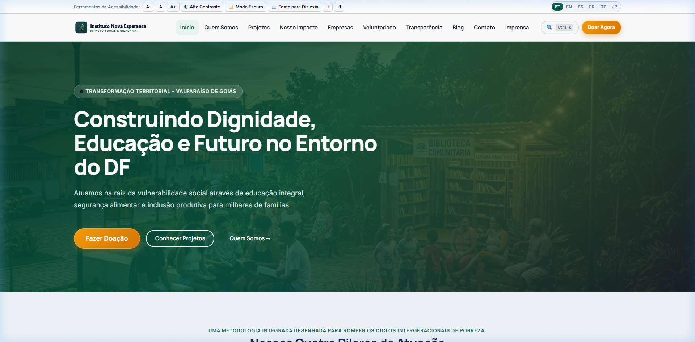
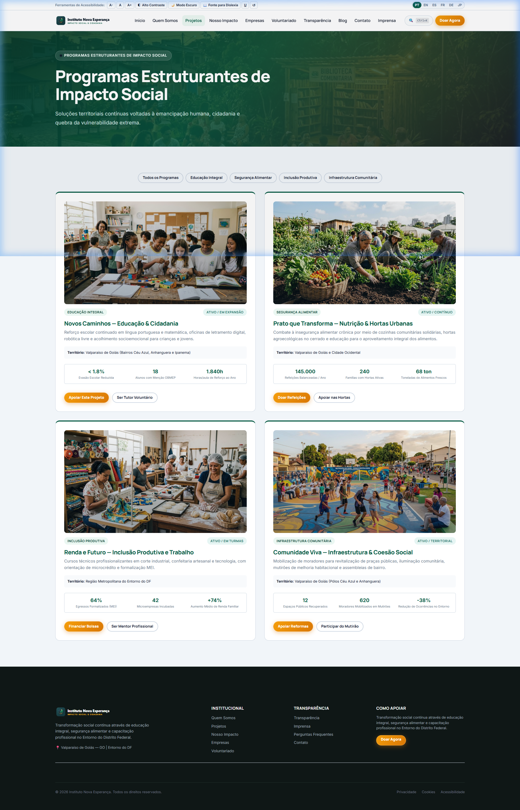
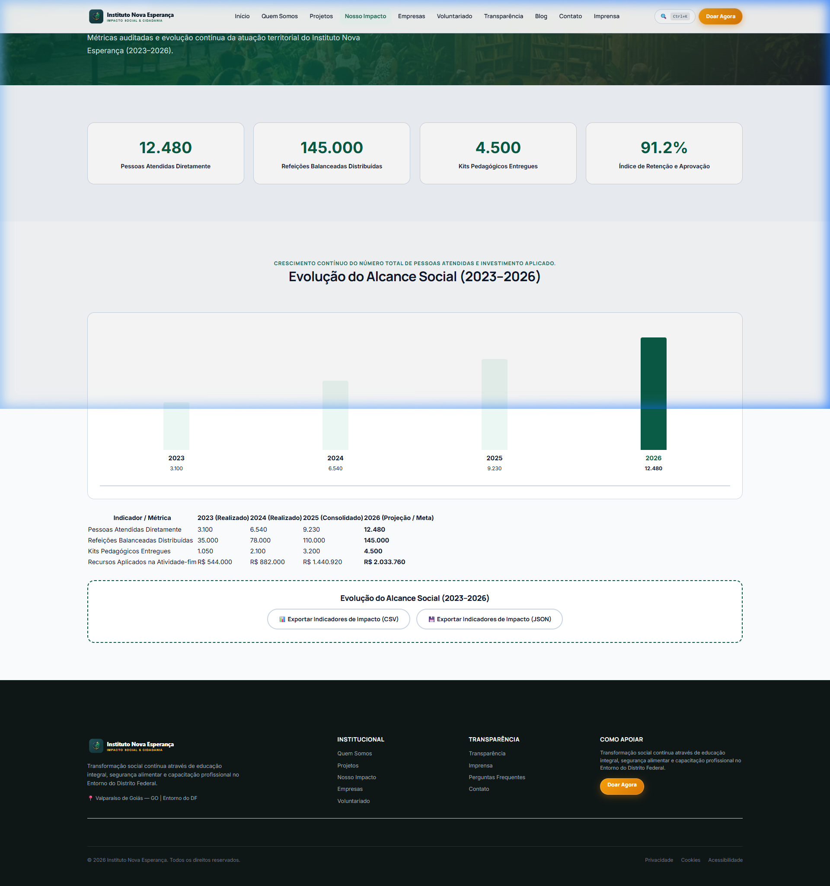

<div align="center">

<p align="center">
  
</p>


<p align="center"></p>

# Instituto Nova Esperança

**Plataforma institucional multilíngue**

[](https://developer.mozilla.org/docs/Web/HTML)
[](https://developer.mozilla.org/docs/Web/JavaScript)
[](package.json)

</div>

<p align="center">
  
</p>

## Sobre o projeto

Este repositório contém um site institucional com páginas organizadas por idioma, dados em arquivos JSON e scripts para desenvolvimento, compilação e verificação do projeto.

Os diretórios de páginas incluem:

| Idioma | Diretório |
| --- | --- |
| Português (Brasil) | `pt-BR/` |
| Inglês (Estados Unidos) | `en-US/` |
| Espanhol | `es-ES/` |
| Francês | `fr-FR/` |
| Alemão | `de-DE/` |
| Japonês | `ja-JP/` |

O projeto também inclui arquivos de dados em `assets/data/`, recursos PWA, imagens e documentação de design.

## Executar localmente

Requer Node.js. Na raiz do repositório:

```bash
npm run dev
```

O servidor de desenvolvimento é iniciado pelo script `scripts/dev_server.js`. Consulte a saída do terminal para o endereço local.

## Scripts disponíveis

| Comando | Finalidade |
| --- | --- |
| `npm run dev` | Inicia o servidor local |
| `npm run build` | Gera recursos, compila localidades e constrói páginas |
| `npm run qa` | Executa verificações do projeto |
| `npm run test:i18n` | Verifica os arquivos de idioma |
| `npm run audit:project` | Analisa a organização dos arquivos |

O comando de compilação gera ou atualiza arquivos do projeto. Revise as alterações no Git antes de incluí-las em um commit.

## Estrutura

```text
/
├── assets/data/       # Dados em JSON
├── assets/js/         # Scripts do site
├── docs/              # Capturas e documentação de design
├── scripts/           # Desenvolvimento, build e verificações
├── pt-BR/             # Páginas em português
├── en-US/             # Páginas em inglês
├── es-ES/             # Páginas em espanhol
├── fr-FR/             # Páginas em francês
├── de-DE/             # Páginas em alemão
├── ja-JP/             # Páginas em japonês
├── index.html
├── manifest.webmanifest
└── service-worker.js
```

## Capturas

<p align="center">
  
</p>

<p align="center">
  
</p>

## Documentação

- [Sistema visual](docs/design-system.md)
- [Capturas da plataforma](docs/screenshots/)
- [Licença MIT](LICENSE.txt)
