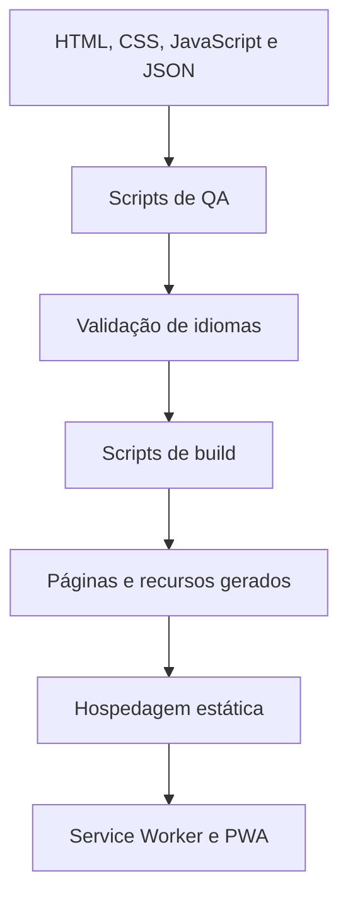

# Arquitetura do Instituto Nova Esperança

## Visão geral

Mantenho este projeto como um site institucional estático multipágina, com conteúdo organizado por localidade, scripts Node.js para validação e geração de recursos e funcionalidades PWA.

## Componentes observados

| Componente | Responsabilidade |
|---|---|
| Páginas por idioma | Conteúdo HTML localizado, como `pt-BR/`, `en-US/`, `es-ES/`, `fr-FR/`, `de-DE/` e `ja-JP/` |
| `assets/` | CSS, JavaScript, imagens, ícones e módulos de interface |
| `lang/` | Arquivos de conteúdo estruturado e recursos de idioma |
| `scripts/` | QA, validação de conteúdo, links, rotas, acessibilidade, SEO e build |
| `manifest.webmanifest` | Metadados de instalação PWA |
| `service-worker.js` | Estratégia de cache e recursos offline |

## Fluxo de construção e publicação

## Internacionalização

Organizo conteúdo por localidade e mantenho verificações específicas de traduções. O comando `npm run test:i18n` executa o verificador de recursos multilíngues.

## Qualidade

O workflow `Instituto quality` executa `npm run qa`, `npm run test:i18n` e `npm run build`. Os scripts de QA verificam rotas, imagens, links, semântica, conteúdo, SEO e acessibilidade. A execução automatizada não substitui auditorias manuais com leitores de tela, teclado e dispositivos reais.

## Limites atuais

A estrutura que analisei é estática e baseada em arquivos; não documento banco de dados de negócio ou backend transacional neste projeto.

## Referências

- [README](../../README.md)
- [Design system](../design-system.md)
- [Política de segurança](../../SECURITY.md)
- [Decisão arquitetural atual](../decisions/0001-current-architecture.md)
